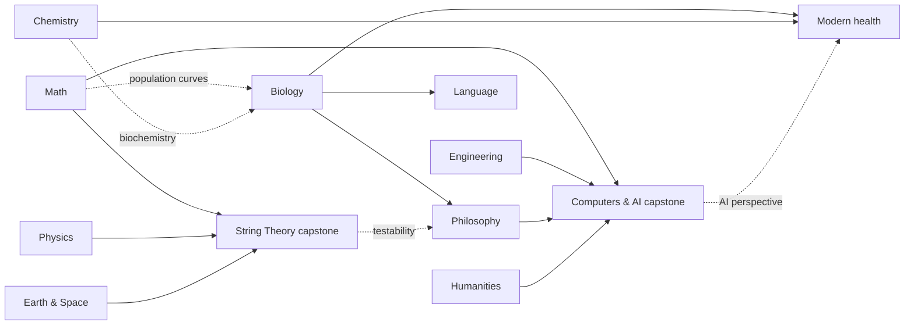

# Connections

How the subjects build on each other and what they roll up to. Each track is
also the story arc for its subjects' movies. Alternatives to each track are
kept in [`track-options.md`](track-options.md).

## All tracks

| Track | Subjects (high school → college) | Rolls up to |
|---|---|---|
| Math | Algebra, Geometry & Trigonometry, Precalculus & Calculus, Statistics & Probability, Computer Science → Calculus & Differential Equations, Linear Algebra, Probability & Statistics, Discrete Mathematics, Proof-Based Mathematics | String Theory, Computers & AI |
| Physics – Unification | Physics → Classical Mechanics, Electromagnetism, Thermal & Statistical Physics, Quantum Mechanics, Relativity | String Theory |
| Earth & Space – Cosmic origins | Earth & Space Science | String Theory |
| Engineering – Control & information | Engineering | Computers & AI |
| Philosophy – Logic → computers | Logic, Philosophy of Science, Epistemology & Metaphysics, Philosophy of Mind, Ethics | Computers & AI |
| Humanities – The spread of ideas | English Language & Literature, History, Government & Economics | Computers & AI |
| Biology | Biology → Molecular & Cell Biology, Genetics & Evolution | Philosophy, language, modern health |
| Chemistry – Elements to life | Chemistry → General Chemistry, Organic Chemistry & Biochemistry, Physical Chemistry | Modern health |
| Spanish | Spanish | Stands alone |

## Math → string theory and computers

Everything starts on the Cartesian plane: once numbers become points, every
equation becomes a picture. Each step after that stretches the plane further.

| Step | What changed | Where it lives |
|---|---|---|
| Descartes (1637) | Algebra and geometry merge: an equation is a curve | Algebra |
| Newton & Leibniz (1680s) | Slopes and areas on the plane become calculus | Precalculus & Calculus |
| Gauss & Riemann (1800s) | The plane can curve and have any number of dimensions | Linear Algebra, Proof-Based Math |
| Einstein's era (1900–1950) | A group of mathematicians and physicists take math to the next level (below) | Relativity, Quantum Mechanics, Computers & AI |

**The Einstein-era group** (centered on Göttingen, then Princeton's Institute
for Advanced Study, where Einstein, Gödel, and von Neumann all worked):

- **Minkowski** – space and time become one 4-D coordinate system (spacetime).
- **Einstein** – uses Riemann's curved geometry for general relativity (1915).
- **Hilbert** – infinite-dimensional spaces, later the math of quantum mechanics.
- **Noether** – every symmetry gives a conservation law (1918).
- **Gödel** – some true statements can never be proven (1931).
- **Turing** – defines what any machine can compute (1936).
- **von Neumann** – quantum math, and the stored-program design every modern
  computer still uses (1945).

**It splits into two capstone subjects:**

- **[String Theory](subjects/college/string-theory.md)** – relativity's
  geometry + quantum mechanics + Noether's symmetries, pushed to extra
  dimensions. Developed from the late 1960s on; still an unconfirmed candidate
  theory, and the agent should grade students on knowing that.
- **[Computers & AI](subjects/college/computers-and-ai.md)** – Turing → von
  Neumann → Shannon's information theory (1948) → modern computers → AI.

## Physics → String Theory: unification

Physics keeps finding that two separate things are one thing.

| Step | What was unified | Where it lives |
|---|---|---|
| Newton (1687) | Falling apples and orbiting planets: one law of gravity | Physics, Classical Mechanics |
| Maxwell (1865) | Electricity, magnetism, and light | Electromagnetism |
| Einstein (1905, 1915) | Space and time; then gravity and geometry | Relativity |
| Quantum era (1900–1930) | Waves and particles | Quantum Mechanics, Thermal & Statistical Physics |
| Standard Model (1960s–70s) | Electromagnetism and the weak force; all known particles | Quantum Mechanics |
| Next | Gravity and quantum mechanics | String Theory |

## Earth & Space → String Theory: cosmic origins

| Step | What changed |
|---|---|
| Copernicus (1543) | The Sun, not Earth, is at the center |
| Kepler & Galileo (1600s) | Elliptical orbits; telescopes show moons and phases |
| Newton (1687) | The same gravity runs the sky and the ground |
| Hubble (1929) | The universe is expanding |
| Big Bang afterglow (1965) | Leftover light from the early universe is found |
| Dark matter & dark energy (1970s–1998) | Most of the universe is something we can't see; the earliest moments need String Theory-level physics |

## Engineering → Computers & AI: control and information

| Step | What changed |
|---|---|
| Watt's governor (1788) | The first feedback machine: an engine that regulates itself |
| Maxwell, "On Governors" (1868) | Feedback becomes math |
| Telegraph & telephone (1840s–1870s) | Signals carry information over wires |
| Transistor (1947) | A tiny electronic switch |
| Integrated circuit (1958–59) | Many transistors on one chip |
| Robots & autonomous systems | Feedback + computing + sensors → machines that act on their own |

## Philosophy → Computers & AI: logic becomes machines

Biology rolls up into philosophy; this is where philosophy goes next.

| Step | What changed | Where it lives |
|---|---|---|
| Aristotle (300s BCE) | Rules for valid reasoning (syllogisms) | Logic |
| Boole (1854) | Logic becomes algebra: true/false as 1/0 | Logic |
| Frege (1879) & Russell (1910s) | Formal logic strong enough to build math on | Logic, Epistemology & Metaphysics |
| Gödel (1931) | Some truths can't be proven | Logic, Philosophy of Science |
| Turing (1936, 1950) | A machine that computes anything computable; can machines think? | Philosophy of Mind |
| AI today | What minds, knowledge, and responsibility mean for machines | Philosophy of Mind, Ethics |

## Humanities → Computers & AI: the spread of ideas

Each step is an invention that changed how ideas spread, and each changed
history, government, and the economy along with it.

| Step | What changed | Where it lives |
|---|---|---|
| Writing in Sumer (~3200 BCE) | Laws, records, and stories outlive their authors | History, English |
| Printing press (~1450) | Books become cheap; literacy, the Reformation, and the Scientific Revolution spread | History, English |
| Enlightenment & revolutions (1700s) | Locke, Smith, the U.S. Constitution (1787), the French Revolution | Government & Economics |
| Industrial Revolution (1760s–1900) | Machines, factories, cities, newspapers, and mass schooling | History, Government & Economics |
| Telegraph, radio, TV (1840s–1950s) | News and ideas move instantly to millions | History, English |
| Information age | Internet, social media, and AI change how ideas are made and spread | Computers & AI |

## Biology → philosophy, language, and modern health

The language roll-up is about how language evolved and how the brain produces
it. It is separate from the Spanish subject, which stands alone.

Cells → DNA → evolution, then three roll-ups:

- **Philosophy** – what life is, what a mind is, and bioethics.
- **Language** – how language evolved, how the brain produces it, and DNA as a
  code that is read and translated.
- **Modern health** – genomics, vaccines, gene editing (CRISPR), and medicine.

## Where biology meets math and computers

- **Population** – Darwin got the idea for natural selection after reading
  Malthus on population growth (1838). Exponential vs. limited (logistic)
  growth curves, Hardy–Weinberg (1908, co-written by a mathematician), and
  Fisher's statistics all plot on the Cartesian plane.
- **Computers + AI today** – neural networks started as a model of neurons
  (McCulloch & Pitts, 1943); computers made genome sequencing possible;
  AlphaFold predicts protein shapes (2020); AI now reads scans and helps find
  drugs.

## Chemistry → modern health: from elements to life

| Step | What changed | Where it lives |
|---|---|---|
| Lavoisier (1789) | Mass is conserved; chemistry becomes measurement | Chemistry, General Chemistry |
| Dalton (1808) | Everything is made of atoms | Chemistry, General Chemistry |
| Wöhler (1828) | An organic compound made from inorganic ones: life's chemistry is ordinary chemistry | Organic Chemistry & Biochemistry |
| Mendeleev (1869) | The periodic table predicts missing elements | Chemistry, General Chemistry |
| Lewis (1916) & Pauling (1939) | Bonds are shared electrons, explained by quantum mechanics | Physical Chemistry |
| Biochemistry & DNA (1953) | The chemistry of life, read molecule by molecule | Organic Chemistry & Biochemistry |
| Modern health | Drugs, vaccines, and diagnostics designed at the molecular level | — |
